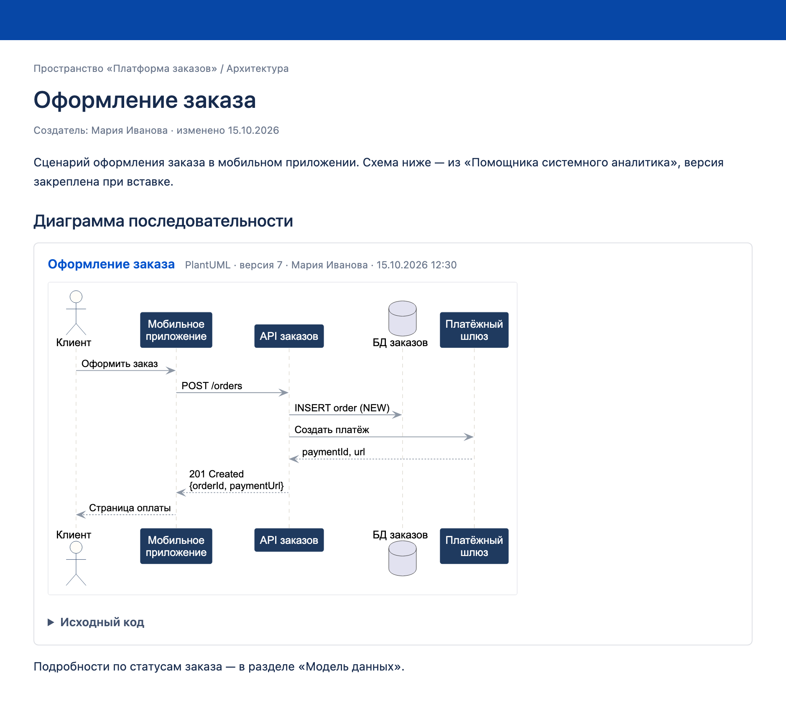
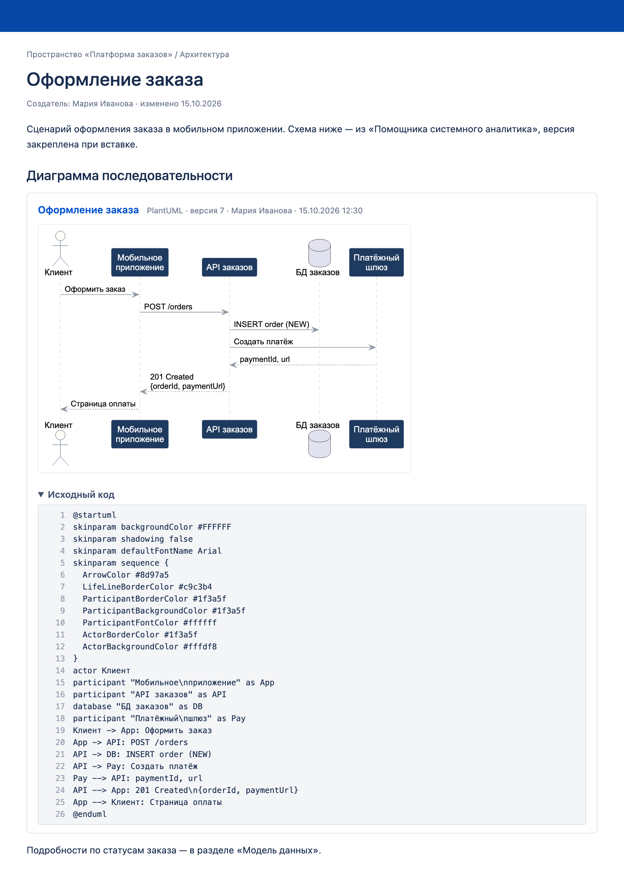

# Виджет «Помощник системного аналитика» для Confluence

Макрос для Confluence Data Center и Server: диаграммы и спецификации из
[«Помощника системного аналитика»](https://helper-sa.ru) прямо на страницах — по ссылке «Поделиться».

## Как выглядит

- **Заголовок** — название документа со ссылкой на источник, инструмент, версия, автор и дата.
- **Картинка** — миниатюра заданной ширины; щелчок открывает её в полном размере.
  Картинка есть у PlantUML, BPMN и DBML, у остальных форматов — только ссылка и код.
- **«Исходный код»** — раскрывается по щелчку, с подсветкой и номерами строк:

Ссылка на документ закрепляет версию, которая была текущей при вставке: документ меняется — страница нет.
Чтобы показать свежую версию, очистите поле «Версия документа» в параметрах макроса и сохраните.

## Установка

Нужны права администратора Confluence (Data Center или Server 7.19–8.x).

1. Скачайте файл `helper-sa-confluence-widget-<версия>.jar` со страницы
   [Releases](https://github.com/vt244/helper-sa-confluence-widget/releases).
2. **Администрирование → Управление приложениями → Загрузить приложение** — выберите скачанный файл.
3. **Администрирование → Настройки → Помощник системного аналитика** — проверьте список разрешённых сайтов.
   По умолчанию там `https://helper-sa.ru`; свой экземпляр helper-sa добавьте отдельной строкой.

Сервер Confluence и браузеры читателей должны иметь доступ к сайту helper-sa.

## Добавление на страницу

1. В «Помощнике системного аналитика» откройте документ и нажмите **«Поделиться»**
   (или поделитесь версией в истории версий) — скопируйте ссылку.
2. В Confluence: **Вставить → Другие макросы → «Помощник системного аналитика»**.
3. Вставьте ссылку и при желании задайте ширину миниатюры (по умолчанию 600 px) → **Вставить**.
